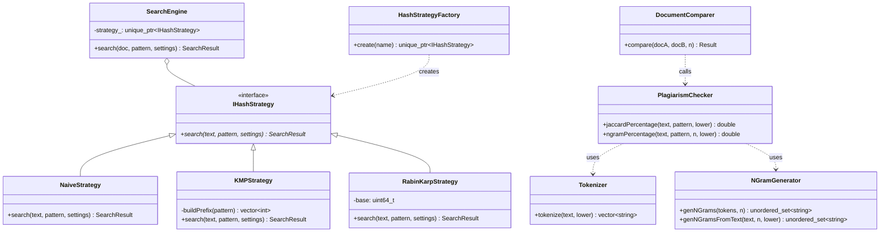

# Digital Plagiarism Checker & String Search Workbench

[](https://opensource.org/licenses/MIT)
[](https://isocpp.org/)
[](https://github.com/ocornut/imgui)

A high-performance C++ workbench for digital plagiarism detection and pattern search. The engine provides exact pattern-matching implementations (**Naive**, **Knuth-Morris-Pratt**, and **Rabin-Karp**) along with document similarity measures (**Jaccard Token Similarity** and **$N$-gram overlap analysis**), accessible through both a Command-Line Interface (CLI) and an interactive **Dear ImGui** Desktop graphical interface.

---

## Table of Contents
1. [Architectural Overview](#architectural-overview)
2. [Algorithmic Deep Dives](#algorithmic-deep-dives)
   - [Naive String Search](#1-naive-string-search-brute-force)
   - [Knuth-Morris-Pratt (KMP)](#2-knuth-morris-pratt-kmp-algorithm)
   - [Rabin-Karp (Rolling Hash)](#3-rabin-karp-algorithm)
   - [Jaccard Token Similarity](#4-jaccard-token-overlap)
   - [$N$-gram Overlap Analysis](#5-n-gram-set-overlap)
3. [Time and Space Complexity Analysis](#time-and-space-complexity-analysis)
4. [System Architecture Diagram](#system-architecture-diagram)
5. [Prerequisites & Build Instructions](#prerequisites--build-instructions)
6. [Usage Guide](#usage-guide)
7. [License](#license)

---

## Architectural Overview

The application is designed following object-oriented principles, utilizing the **Strategy Design Pattern** to allow interchangeable search algorithms at runtime.

- **`IHashStrategy` & Concrete Strategies**: Defines the unified interface `search()` implemented by `NaiveStrategy`, `KMPStrategy`, and `RabinKarpStrategy`.
- **`HashStrategyFactory`**: Factory providing polymorphic strategy instantiation based on algorithm name (`"rabin"`, `"kmp"`, `"naive"`).
- **`Tokenizer`**: Cleans and normalizes unstructured text, removing punctuation and converting characters to lowercase for case-insensitive tokenization.
- **`NGramGenerator`**: Constructs contiguous sequence tuples of $N$ tokens delimited by non-printable characters (`\x1F`) to capture phrase-level and syntactic structure.
- **`TextDocument`**: Models file input/output, file metadata, word counting, and token extraction.
- **`PlagiarismChecker` & `DocumentComparer`**: Computes set-theoretic overlap between token sets and $N$-gram sets across two documents.
- **`SearchEngine`**: Orchestrates search queries through the active strategy.

---

## Algorithmic Deep Dives

### 1. Naive String Search (Brute-Force)

The Naive algorithm slides the pattern string $P$ of length $m$ over the text $T$ of length $n$ one character at a time. At each starting index $i \in [0, n - m]$, it performs character-by-character comparisons:

```
Text:    [ A B C D A B C E ]
Pattern: [ A B C E ]
Step 0:   A-A, B-B, C-C, D != E (Mismatch at index 3) -> Shift by 1
Step 1:   B != A -> Shift by 1
...
```

- **Mechanism**: Straightforward nested iteration.
- **Handling Settings**: Supports case-insensitivity via character transforms and whole-word checks by ensuring neighboring boundary characters are non-alphanumeric.

### 2. Knuth-Morris-Pratt (KMP) Algorithm

The KMP algorithm eliminates redundant comparisons by preprocessing the pattern into a Longest Prefix Suffix (**LPS** or $\pi$) array. 

#### Preprocessing ($\pi$ Table Construction)
$\pi[i]$ stores the length of the longest proper prefix of $P[0..i]$ that is also a suffix of $P[0..i]$.
- When a mismatch occurs at $T[i] \neq P[j]$, the pattern pointer $j$ shifts to $\pi[j - 1]$ rather than resetting to index `0`, avoiding backtracking over characters in $T$ that have already been matched.

```mermaid
graph TD
    A[Start Text Scan i=0, Pattern j=0] --> B{T[i] == P[j]?}
    B -- Yes --> C[Increment i++, j++]
    C --> D{j == Pattern Length?}
    D -- Match Found! --> E[Record Occurrence at i - m, Reset j = pi[j-1]]
    D -- No --> B
    B -- Mismatch & j > 0 --> F[Fallback: j = pi[j-1]]
    F --> B
    B -- Mismatch & j == 0 --> G[Advance Text Pointer: i++]
    G --> B
```

### 3. Rabin-Karp Algorithm

Rabin-Karp transforms the string matching problem into numerical hash comparisons using a **rolling hash**.

#### Hash Formulation
Using a polynomial rolling hash with base $B = 1315423911$ over 64-bit unsigned integers (`uint64_t`) with natural modulo $2^{64}$:
$$\text{Hash}(S) = \sum_{k=0}^{m-1} S[k] \cdot B^{m - 1 - k} \pmod{2^{64}}$$

#### Rolling Mechanism
When sliding the search window from index $i-1$ to $i$, the new hash is computed in $O(1)$:
$$\text{Hash}_{new} = \left(\text{Hash}_{old} - T[i-1] \cdot B^{m-1}\right) \cdot B + T[i + m - 1]$$

If $\text{Hash}(T[i..i+m-1]) == \text{Hash}(P)$, a secondary direct character verification confirms the match, protecting against rare hash collisions.

### 4. Jaccard Token Overlap

Jaccard similarity quantifies lexical overlap by treating the documents as sets of distinct tokenized words:
$$J(A, B) = \frac{|A \cap B|}{|A \cup B|} \times 100\% = \frac{|A \cap B|}{|A| + |B| - |A \cap B|} \times 100\%$$

- **Range**: $0\%$ (no common vocabulary) to $100\%$ (identical unique vocabulary).
- **Strengths**: Invariant to word reordering; catches bag-of-words plagiarism.

### 5. $N$-gram Set Overlap

While Jaccard operates on individual words, $N$-gram analysis captures contiguous phrases of length $N$ (e.g., $N=3$ for trigrams).

```
"the quick brown fox jumps"
Trigrams: {"the quick brown", "quick brown fox", "brown fox jumps"}
```

The overlap percentage is calculated using set intersection of $N$-gram sets:
$$\text{Overlap}_N(A, B) = \frac{|\text{NGrams}_N(A) \cap \text{NGrams}_N(B)|}{|\text{NGrams}_N(A) \cup \text{NGrams}_N(B)|} \times 100\%$$

- **Strengths**: Detects verbatim phrase copying and localized paragraph theft, even if surrounded by rearranged text.

---

## Time and Space Complexity Analysis

Let:
- $n = |T|$ (Length of Text in characters)
- $m = |P|$ (Length of Pattern in characters)
- $W_A, W_B$ (Total word count in Documents A and B)
- $U_A, U_B$ (Unique word/token count in Documents A and B)
- $G_A, G_B$ (Total $N$-grams generated from Documents A and B, where $G \approx W - N + 1$)
- $\Sigma$ (Alphabet size)

### Complexity Breakdown Table

| Algorithm / Component | Best Time | Average Time | Worst Time | Space Complexity | Notes |
| :--- | :---: | :---: | :---: | :---: | :--- |
| **Naive Search** | $O(n)$ | $O(n + m)$ | $O(n \times m)$ | $O(1)$ | Worst case occurs with repeated characters (e.g., `AAAA...B` matching `AAA...A`). |
| **KMP Search** | $O(n + m)$ | $O(n + m)$ | $O(n + m)$ | $O(m)$ | Precomputes $\pi$ array in $O(m)$ time and space. Never backtracks text pointer. |
| **Rabin-Karp Search** | $O(n + m)$ | $O(n + m)$ | $O(n \times m)$ | $O(1)$ | Worst case occurs if hash collision rate is pathological requiring constant verification. |
| **Tokenizer** | $O(n)$ | $O(n)$ | $O(n)$ | $O(n)$ | Linear pass character-by-character to extract alphanumeric tokens. |
| **TextIndexer (Inverted)** | $O(n)$ | $O(n)$ | $O(n)$ | $O(W \cdot L)$ | Maps word tokens to character start offsets using hash maps. |
| **Jaccard Token Overlap** | $O(W_A + W_B)$ | $O(W_A + W_B)$ | $O(W_A \cdot W_B)$ | $O(U_A + U_B)$ | Hash set insertion and lookups are $O(1)$ average; worst-case hash collisions are $O(U)$. |
| **$N$-Gram Similarity** | $O(W_A + W_B)$ | $O(W_A + W_B)$ | $O(G_A \cdot G_B)$ | $O(G_A + G_B)$ | Set hashing of composite strings with length $N \times L_{avg}$. |

---

## System Architecture Diagram



---

## Prerequisites & Build Instructions

### Prerequisites
- **C++ Compiler**: GCC / MinGW-W64 (`g++` supporting C++17 or C++20).
- **CMake**: Version 3.16 or newer.
- **Operating System**: Windows 10/11, Linux, or macOS.
- **Graphics Support**: OpenGL 3.3 compatible GPU drivers (for GUI mode).

### Building with CMake

1. Clone or open the workspace:
   ```bash
   cd d:/Projects/Digital-Plagiarism-Checker
   ```

2. Configure CMake:
   ```bash
   cmake -B build -G "MinGW Makefiles"
   ```

3. Compile the targets:
   ```bash
   cmake --build build --config Release
   ```

This generates:
- `build/PlagiarismCheckerCLI.exe`: Standalone command-line utility.
- `build/PlagiarismCheckerGUI.exe`: Interactive Dear ImGui desktop application.

---

## Usage Guide

### 1. Graphical User Interface (GUI)
Run `build/PlagiarismCheckerGUI.exe`:
- **Document Similarity Tab**:
  - Enter or browse file paths for Document 1 (`file1.txt`) and Document 2 (`file2.txt`).
  - Adjust the $N$-gram size slider (default: 3).
  - Click **"Compare Documents"** to view real-time Jaccard Token Overlap % and $N$-gram overlap % with side-by-side text display.
- **Pattern Search Tab**:
  - Load a target document.
  - Type in your search pattern.
  - Select algorithm (**Rabin-Karp**, **KMP**, or **Naive**).
  - Toggle options: **Ignore Case**, **Whole Word**, **Verify Exact Matches**.
  - Hit **"Search"** to inspect total occurrences, match offset coordinates, and benchmarked execution time in microseconds.
- **Export**: Export results to `search_output.txt` with a single click.

### 2. Command Line Interface (CLI)
Run `build/PlagiarismCheckerCLI.exe`:
```text
=== Advanced Search & Plagiarism Tool ===
Enter path to text file: file1.txt
Loaded 'file1.txt' (approx 17 words).
Enter pattern to search: plagiarism
Choose algorithm [rabin/kmp/naive] (default rabin): kmp
Ignore case? [y/n] (default y): y
Whole-word search? [y/n] (default n): y
Verify matches with exact compare? [y/n] (default y): y
n-gram size for similarity (default 3): 3
Search complete. Results saved to search_output.txt
Would you like to compare this file with another document for similarity? [y/n]: y
Enter path to second file: file2.txt
Comparison results:
 - Jaccard token overlap: 42.8571%
 - 3-gram overlap: 28.5714%
```

---

## License

This project is open-source software licensed under the [MIT License](LICENSE).  
Copyright (c) 2026 **Nofil Ansari**.
